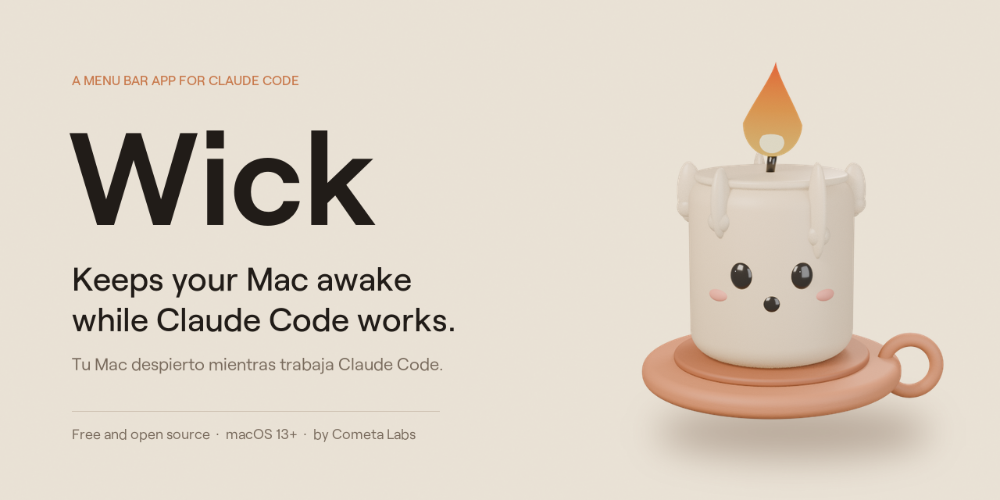
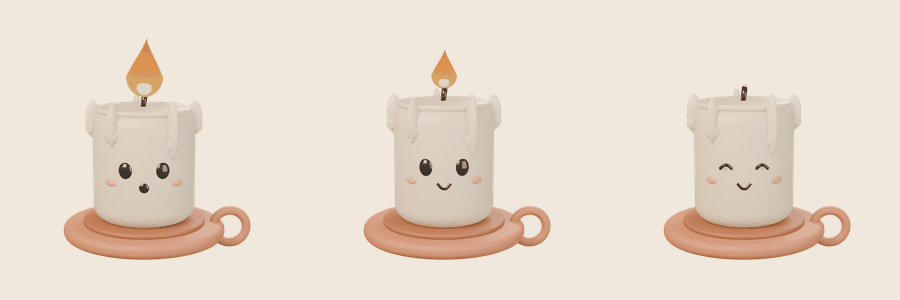

<p align="center">
  
</p>

<p align="center">
  <a href="https://wick.cometalabs.io/es/"><b>wick.cometalabs.io</b></a> ·
  <a href="../../releases/latest">Descargar</a> ·
  <a href="#cómo-funciona">Cómo funciona</a> ·
  <a href="README.md">Read in English</a>
</p>

<p align="center">
  
</p>

**Wick** es una velita de plastilina que vive en tu barra de menú. Se enciende cuando un agente de IA se pone a trabajar, impide que el Mac se duerma a mitad de la tarea y se apaga sola cuando termina.

Sigue a tus agentes, no a un temporizador: a Claude Code por hooks, y a Codex, Gemini CLI, Cursor Agent, OpenCode, Aider, Amp, Goose y otros agentes de terminal vigilando sus procesos.

## Por qué

Si el Mac se duerme a mitad de una tarea larga, el agente se para. Con las apps de siempre eliges «2 horas» y esperas haber acertado. Wick solo mantiene el Mac despierto mientras hay trabajo de verdad.

| | Temporizador clásico | Wick |
| --- | --- | --- |
| Se enciende | Cuando eliges una duración | Sola, cuando un agente empieza |
| Se apaga | Cuando acaba el tiempo | 2 min después de que el agente termine |
| El agente te pide permiso | Sigue gastando batería | Deja descansar al Mac (configurable) |
| Varias sesiones a la vez | No las ve | Las lista por proyecto |
| Tapa cerrada | Todo el rato | Solo mientras un agente trabaja |

## Qué hace

- **Claude Code, con precisión.** Los hooks le cuentan cuándo empieza una sesión, cuándo te necesita y cuándo termina. Funciona en la terminal, en Cursor y en la app de Claude.
- **Otros agentes, solos.** Codex, Gemini CLI, Cursor Agent, OpenCode, Aider, Amp, Goose, Qwen Code, Copilot CLI, Crush y Factory Droid se detectan por su proceso: si el agente o lo que acaba de lanzar gasta CPU, está trabajando. Lo que lleva mucho rato abierto, como un servidor de desarrollo, no cuenta.
- **Te dice quién te espera.** La velita se pone naranja cuando una sesión de Claude Code necesita tu OK, y el menú lista cada agente con su proyecto.
- **Tapa cerrada, solo mientras un agente trabaja.** Opcional. Pide tu contraseña una vez y desactiva el reposo al cerrar la tapa solo mientras un agente trabaja (o con el modo manual activo). Al terminar, al salir de la app, si se cuelga o con la batería por debajo del 15 %, el Mac vuelve a dormir con normalidad.
- **Se arregla tras un reinicio.** Si el Mac se apagó con el modo tapa activo, Wick ve que el reposo sigue desactivado y te ofrece arreglarlo.
- **Modo manual.** 15 min, 1 h, 8 h o hasta que la apagues.
- **Local y sencilla.** Aserciones de energía de macOS (las mismas que `caffeinate`). Sin red, sin analíticas, sin cuenta.
- **En castellano e inglés**, según el idioma de tu Mac.

## Instalar

1. Descarga **Wick.dmg** desde la [última versión](../../releases/latest) o [wick.cometalabs.io](https://wick.cometalabs.io/es/), ábrelo y arrastra la velita a **Aplicaciones**.
2. Abre Wick desde Aplicaciones. Está firmada con el Developer ID de Cometa Labs; hasta que Apple termine la notarización, la primera vez ve a **Ajustes del Sistema → Privacidad y seguridad → Abrir igualmente**.
3. Wick no tiene ventana: busca la velita en tu barra de menú, arriba a la derecha. Si la barra está llena, macOS la esconde detrás de la cámara; mantén pulsada ⌘ y arrastra otros iconos para hacerle sitio.
4. Si usas Claude Code, acepta los hooks para seguirlo al detalle. Los demás agentes funcionan al momento.

### Qué cambia en tu configuración

Para Claude Code, Wick añade estos hooks a `~/.claude/settings.json`. Antes guarda una copia en `settings.json.wick-backup`, respeta los hooks que ya tengas y, si el archivo es un enlace a tus dotfiles, escribe en el archivo real:

`SessionStart` · `UserPromptSubmit` · `PreToolUse` · `PostToolUse` · `Notification` · `Stop` · `SubagentStop` · `PreCompact` · `SessionEnd`

Todos llaman a `~/.wick/hook`, que guarda el estado de la sesión en `~/.wick/sessions/` y sale en milisegundos. Nunca bloquea a Claude Code ni cambia lo que hace. Para quitarlos, desmarca **Claude Code (hooks)** en el menú, o:

```sh
/Applications/Wick.app/Contents/MacOS/Wick --uninstall-hooks
```

Hazlo antes de borrar la app. Si no, los hooks se quedan en tu configuración (no hacen nada, pero ensucian).

## Cómo funciona

```
Claude Code ──hook──▶ ~/.wick/hook ──▶ ~/.wick/sessions/<id>.json ─┐
Codex, Gemini CLI… ──── proceso + CPU (cada 3 s) ──────────────────┤
                                                                   ▼
                                                    Wick (cada segundo)
                              ├─ un agente trabaja      → PreventUserIdleSystemSleep
                              ├─ terminó hace < 2 min   → sigue despierta, por si continúa
                              └─ modo tapa activado     → escribe 1/0 en ~/.wick/lid-want
                                                            └▶ ayudante root → pmset disablesleep
```

- Si Claude Code se cierra sin despedirse, Wick ve que su proceso ya no existe. Si una sesión pasa 30 minutos sin ningún evento (por ejemplo, la paraste con Esc), se da por terminada.
- El ayudante de la tapa corre como root con el script dentro de la propia llamada (`sh -c`), no desde un archivo del paquete de la app, así que nadie puede cambiarlo antes de que se ejecute. Solo lee un byte de `~/.wick/lid-want` y al salir siempre restaura `pmset -a disablesleep 0`.

## Compilar

Necesitas macOS 13 o posterior y las Command Line Tools (`xcode-select --install`).

```sh
./build.sh          # Wick.app universal (Apple Silicon + Intel)
./build.sh --dmg    # además Wick.dmg (firmado si hay un Developer ID en el llavero)
```

Swift, sin dependencias. La mascota se renderiza en Blender (`art/wick.py`, tres estados × 24 frames) y se posprocesa con Python (`art/post.py`, `art/banner.py`). Los frames ya están en `Resources/mascot/`, así que no hace falta Blender para compilar. La web está en `site/`.

## Créditos

Wick parte de [Caffeinator](https://github.com/kraayenjon/caffeinator), de Jon Kraayen (MIT), y añade el seguimiento de agentes, la tapa cerrada ligada al agente, el arreglo tras reinicios y la mascota de plastilina. Hecha por [Cometa Labs](https://cometalabs.io), estudio de producto digital en Palma de Mallorca.

Licencia MIT.
