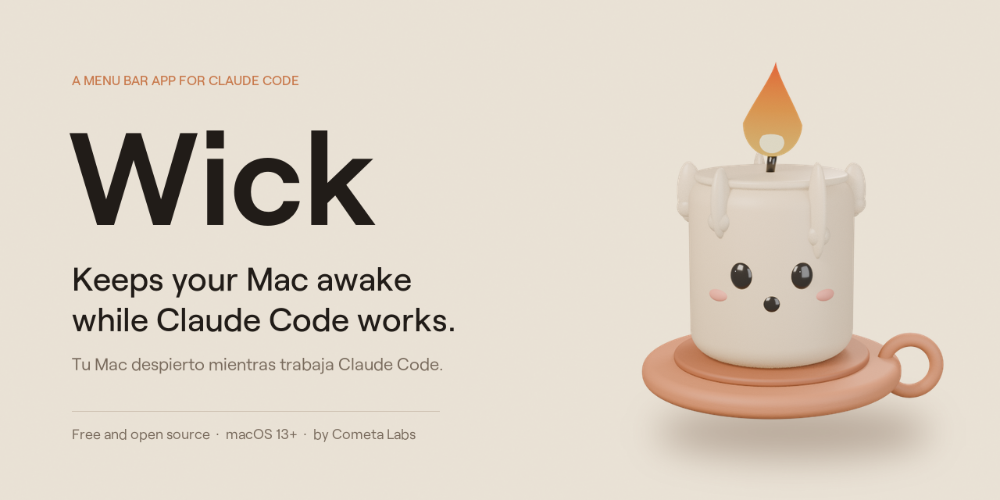
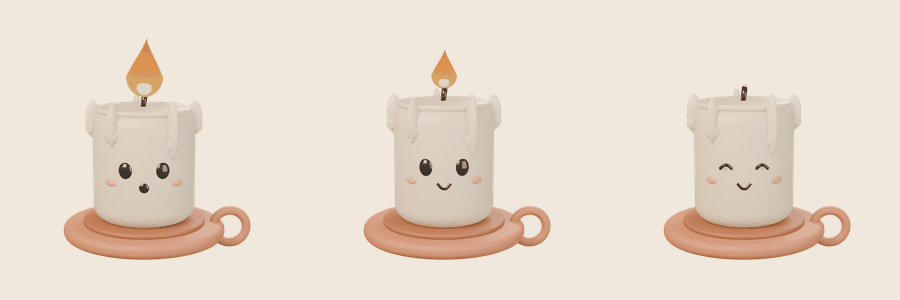

<p align="center">
  
</p>

<p align="center">
  <a href="https://wick.cometalabs.io"><b>wick.cometalabs.io</b></a> ·
  <a href="../../releases/latest">Download</a> ·
  <a href="#how-it-works">How it works</a> ·
  <a href="README.es.md">Leer en español</a>
</p>

<p align="center">
  
</p>

**Wick** is a little clay candle that lives in your menu bar. It lights up when an AI agent starts working, keeps your Mac from sleeping halfway through, and blows itself out when the work is done.

It follows your agents instead of a timer: Claude Code through hooks, and Codex, Gemini CLI, Cursor Agent, OpenCode, Aider, Amp, Goose and other terminal agents by watching their processes.

## Why

If your Mac sleeps halfway through a long run, the agent stops. With a classic keep-awake app you pick "2 hours" and hope you guessed right. Wick only keeps the Mac awake while there is real work going on.

| | Classic timer | Wick |
| --- | --- | --- |
| Turns on | When you pick a duration | By itself, when an agent starts |
| Turns off | When the timer runs out | 2 min after the agent finishes |
| Agent needs your approval | Keeps burning battery | Lets the Mac rest (optional) |
| Several sessions at once | Can't see them | Lists each one by project |
| Lid closed | The whole time | Only while an agent works |

## Features

- **Claude Code, precisely.** Hooks tell Wick when a session starts, needs you or finishes. Works in the terminal, in Cursor and in the Claude app.
- **Other agents, automatically.** Codex, Gemini CLI, Cursor Agent, OpenCode, Aider, Amp, Goose, Qwen Code, Copilot CLI, Crush and Factory Droid are detected by their process: if the agent or the commands it just launched are using CPU, it's working. Long-running children like dev servers don't count.
- **Shows who needs you.** The menu bar candle turns orange when a Claude Code session is waiting for your approval, and the menu lists every agent with its project.
- **Lid closed, only while an agent works.** Optional. Asks for your password once, then disables lid sleep only while an agent is working (or while manual mode is on). Normal sleep comes back when the work ends, when you quit, if the app crashes, or below 15 % battery.
- **Heals after a restart.** If your Mac shut down with lid mode on, Wick notices that lid sleep is still disabled and offers to fix it.
- **Manual mode.** 15 min, 1 h, 8 h or until you stop it.
- **Local and plain.** macOS power assertions (the same ones as `caffeinate`). No network, no analytics, no account.
- **English and Spanish**, following your system language.

## Install

1. Download `Wick.zip` from the [latest release](../../releases/latest), unzip it and drag **Wick.app** into **Applications**.
2. Open it. Wick isn't signed with an Apple Developer ID yet, so macOS warns you the first time: click **Done**, open **System Settings → Privacy & Security** and click **Open Anyway**. Or in Terminal:

   ```sh
   xattr -dr com.apple.quarantine /Applications/Wick.app
   ```

3. If you use Claude Code, Wick offers to add its hooks for exact tracking. Other agents work right away.

### What it changes in your setup

For Claude Code, Wick adds these hooks to `~/.claude/settings.json`. It backs the file up first as `settings.json.wick-backup`, keeps any hooks you already have, and writes through symlinks if you keep your dotfiles elsewhere:

`SessionStart` · `UserPromptSubmit` · `PreToolUse` · `PostToolUse` · `Notification` · `Stop` · `SubagentStop` · `PreCompact` · `SessionEnd`

Every hook calls `~/.wick/hook`, which saves the session state in `~/.wick/sessions/` and exits in a few milliseconds. It never blocks Claude Code or changes what it does. To remove them, untick **Claude Code (hooks)** in the menu, or run:

```sh
/Applications/Wick.app/Contents/MacOS/Wick --uninstall-hooks
```

Run that before deleting the app. Otherwise the hooks stay in your settings (they do nothing, but they're clutter).

## How it works

```
Claude Code ──hook──▶ ~/.wick/hook ──▶ ~/.wick/sessions/<id>.json ─┐
Codex, Gemini CLI… ──── process + CPU (every 3 s) ─────────────────┤
                                                                   ▼
                                                     Wick (every second)
                                ├─ an agent is working  → PreventUserIdleSystemSleep
                                ├─ finished < 2 min ago → stays awake, in case it continues
                                └─ lid mode on          → writes 1/0 to ~/.wick/lid-want
                                                            └▶ root helper → pmset disablesleep
```

- If Claude Code quits without saying goodbye, Wick notices its process is gone. If a session goes 30 minutes without any event (for example, you stopped it with Esc), it's treated as finished.
- The lid helper runs as root with the script passed inline (`sh -c`), not from a file inside the app bundle, so nothing can swap it before it runs. It only reads one byte from `~/.wick/lid-want` and always restores `pmset -a disablesleep 0` when it exits.

## Build from source

Needs macOS 13+ and the Command Line Tools (`xcode-select --install`).

```sh
./build.sh          # universal Wick.app (Apple Silicon + Intel)
./build.sh --zip    # also Wick.zip for a release
```

Swift, no dependencies. The mascot is rendered in Blender (`art/wick.py`, three moods × 24 frames) and post-processed with Python (`art/post.py`, `art/banner.py`). The frames are already in `Resources/mascot/`, so you don't need Blender to build. The website lives in `site/`.

## Credits

Wick started from [Caffeinator](https://github.com/kraayenjon/caffeinator) by Jon Kraayen (MIT) and adds agent tracking, lid sleep tied to the agent, the restart fix and the clay mascot. Made by [Cometa Labs](https://cometalabs.io), a digital product studio in Palma de Mallorca.

MIT License.
